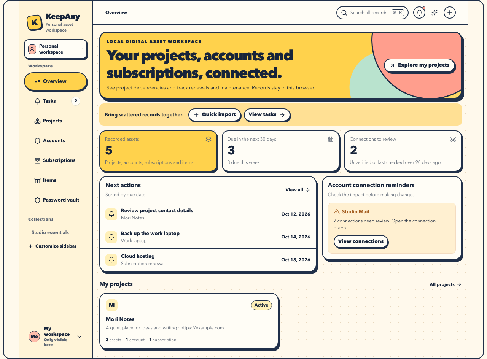

# KeepAny

**A local digital asset workspace for independent developers. Connect projects, domains, accounts, subscriptions, and maintenance.**

[简体中文](README.md) · [Try KeepAny](docs/试用指南.md#english) · [Releases](https://github.com/Syndred/KeepAny/releases) · [Report an issue](https://github.com/Syndred/KeepAny/issues)

Which email does a project use? Where is its domain registered? Which subscriptions still need attention when you change an email or retire a project? KeepAny keeps those records connected in one local workspace, so you can find what to do next.

No registration required. English and Simplified Chinese interfaces. The local core is open source under [AGPL-3.0-only](LICENSE). Optional paid hosting is planned; official cloud sync and paid services are not available yet.



*Screenshot of the actual app using sample records.*

## Download and try

**This is an early preview.** Download the `KeepAny-…-portable.zip` marked `Pre-release` from [GitHub Releases](https://github.com/Syndred/KeepAny/releases). Each release will identify its source revision, checksums, and known limits. GitHub's source ZIP is not the portable app.

The portable package requires **[Node.js 22 or newer](https://nodejs.org/)**. You do not need Git, pnpm, or a build step. Extract it to a folder you can keep:

| System | Start | Stop |
|---|---|---|
| macOS | Double-click `start.command` | Double-click `stop.command` |
| Linux | Run `./start.sh` in the package folder | Run `./stop.sh` |
| Windows | Double-click `start.bat` | Double-click `stop.bat` |

Open **[http://127.0.0.1:4180/](http://127.0.0.1:4180/)**. The server listens only on your computer. Closing the browser does not stop it. If another program is using the port, the launcher reports it rather than choosing a different address. The same browser and address show your existing local records; use a separate browser profile to start empty.

Before updating an existing installation, download and verify a backup, save your edits, close old tabs, and stop the old server. Open the new package in the same browser and at the same address. Save changes before accepting an app-update prompt; investigate the existing server if the port is occupied. See [upgrade steps](docs/试用指南.md#updating-an-existing-installation). Not every older PWA upgrade path has been verified.

In an empty **Overview**, choose **Start with sample records**, then **Add sample records** in Settings. You can also use **Settings → More options → Add sample records**. Then try:

1. Create a project and record its website or domain.
2. Add a login account and connect it to the project.
3. Record a subscription, its renewal date, and its project.
4. Create a maintenance task and review an account's connections and change impact.
5. Create an encrypted `.ka1` backup in **Import & backup**, **save the downloaded file**, then preview and restore it in a separate browser profile.

See the [trial guide](docs/试用指南.md#english) for setup, storage, and recovery. Start with sample records and complete a restore before adding important information.

## What you can do

| Your task | Local features |
|---|---|
| Find a project's records | Projects, accounts, subscriptions, and physical items; collections, tags, search, and a connection graph |
| Keep track of maintenance and costs | Tasks, subscription schedules and renewal records, warranties, and lending history |
| Organize scattered records | Review text, CSV, URL, image, or extracted PDF text before saving; optional AI using your own provider |
| Check before changing a login | Account connections, sources, verification dates, and a checklist for changes you handle yourself |
| Keep login details | A separate encrypted KDBX vault with import, export, and reviewed batch import |
| Take your data with you | Encrypted `.ka1` backup and restore for records, images, history, and the encrypted local vault |

You can record domains in project details and maintenance tasks. KeepAny does not manage registrars or renew domains automatically. Bills and renewal records are your ledger; they do not confirm a third-party charge. Change checklists do not log in, rebind accounts, or cancel services for you.

## Data and AI

- Records are stored locally for the **current browser, profile, and site address**. A different browser, port, or `localhost` address opens a different store. Back up and restore when moving computers. Clearing site data can delete your records.
- The local core works independently. Sync is not a backup: download `.ka1` files regularly, retain their passwords, and check that you can restore them.
- Passwords and persistent model keys use a separate KDBX vault. They are excluded from ordinary assets, global search, MCP, and asset sync. A `.ka1` backup includes the encrypted vault; its master password is still required after restoring. There is no server-side master password reset.
- AI is optional and uses a provider or compatible server you configure. Ordinary Q&A sends only the limited record fields you select. The vault's **full-text AI import** sends the current list, which may contain usernames, passwords, and notes, after you explicitly review its model, destination, and scope. It does not read or send your existing vault or master password. You review the result before saving. See the [vault guide](docs/密码库使用说明.md) and [AI data boundaries](docs/AI功能与验收合同.md), currently in Chinese.

## Preview limits

This preview is for early users who are willing to report problems. Local features have automated and browser verification, but defects may remain. Physical phones, every OS and browser, low-storage conditions, and sudden shutdowns have not all been verified.

Official hosting, background email or closed-page push, password autofill, and cross-device password sync are not provided. The repository contains sync, account-binding, remote-storage, and MCP implementations with partial verification. These are experimental and are not required to try the local app. Commercial feature expansion is paused while local use and recovery are improved.

Read the downloaded package's release notes for its limits. Detailed evidence and remaining work are in the Chinese [project handoff](docs/08-项目进度交接.md).

## Run from source

Use Node.js 22+ and the pnpm version declared by this repository. Install with the lockfile:

```bash
npm install --global pnpm@11.10.0
pnpm install --frozen-lockfile
pnpm dev
```

Development defaults to `http://127.0.0.1:5173/`, with storage separate from the portable app on port 4180. For the fixed local package, see [release/README.md](release/README.md).

```bash
pnpm typecheck
pnpm test
pnpm build
```

Sync tests require an isolated PostgreSQL instance. Read [CONTRIBUTING.md](CONTRIBUTING.md) before changing code. `apps/web` contains the React app; `packages/*` contains the domain model, local repository, and connectors. Design HTML is an archive, not the app.

## Contribute and license

Tell us which step failed, how long it took to find a record, or where entry was cumbersome. Include the app version, OS, browser, and reproduction steps using fictional records. Do not upload real passwords, API keys, or backup files. Follow [SECURITY.md](SECURITY.md) for security reports.

The local core uses [AGPL-3.0-only](LICENSE). Third-party declarations and materials are in [NOTICE.md](NOTICE.md), [SBOM.spdx.json](SBOM.spdx.json), and [legal/third-party](legal/third-party). Commercial use must comply with the applicable licenses.

Future paid services are intended to cover hosting, storage, and operations. Local access and complete export do not require payment. The website, billing, and operations belong to the separate KeepAnyAdm commercial repository and are not distributed here. See the Chinese [product boundaries](docs/00-产品范围与开放边界.md).
