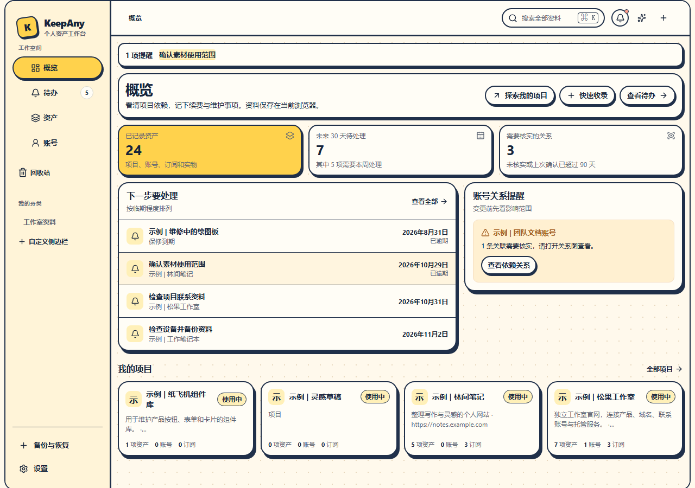

# KeepAny

**独立开发者的本地数字资产工作台。把项目、域名、账号、订阅和维护事项连起来。**

[English](README.en.md) · [官网](https://syndred.github.io/KeepAny/zh/) · [试用指南](docs/试用指南.md) · [发布记录](https://github.com/Syndred/KeepAny/releases) · [反馈问题](https://github.com/Syndred/KeepAny/issues)

项目统一使用 KeepAny，曾以 StackPerch 名称发布。旧 StackPerch GitHub 链接仍转到同一仓库；官网请使用上方的 KeepAny 地址。

一个项目用了哪个邮箱、在哪买的域名、有哪些订阅？换邮箱或停止维护时，还要处理哪些关联服务？KeepAny 把这些资料放进同一个本地工作区，让你沿着关联找到下一步。

无需注册。简体中文和英语界面。本地核心采用 [AGPL-3.0-only](LICENSE) 开源；未来可选付费托管，当前官方云同步和付费服务未开放。



*真实应用截图，内容为示例资料。*

## 下载与试用

**当前为早期测试版。** 请从 [GitHub Releases](https://github.com/Syndred/KeepAny/releases) 获取标注 `Pre-release` 的 `KeepAny-…-portable.zip`。发布页仅提供当前测试版，并列出对应源码版本、校验值和已知限制。不要把 GitHub 的源码 ZIP 当成便携应用包。

便携包需要 **[Node.js 22 或更新版本](https://nodejs.org/)**，无需 Git、pnpm 或编译源码。解压到一个固定文件夹后启动：

| 系统 | 启动 | 停止 |
|---|---|---|
| macOS | 双击 `start.command` | 双击 `stop.command` |
| Linux | 在包目录运行 `./start.sh` | 运行 `./stop.sh` |
| Windows | 双击 `start.bat` | 双击 `stop.bat` |

打开 **[http://127.0.0.1:4180/](http://127.0.0.1:4180/)**。服务仅监听本机；关闭浏览器不会停止服务。若端口已被其他程序使用，启动器会提示，不会改用另一个端口。同浏览器、同地址会显示已有的本地资料；想从空白开始，请自行使用独立浏览器配置。

已有 KeepAny 或 StackPerch 的 `.ka1` 加密备份和 `.kdbx` 密码库可继续使用；仍需各自原密码。更名不改变本地数据位置，使用原浏览器、原地址即可沿用已有资料。

旧版本升级前先下载并验证备份，保存当前编辑，关闭旧标签并停止旧服务，再用原浏览器、原地址打开新版。遇到应用更新提示，按提示保存修改后更新；端口冲突时先核查原服务。详见 [升级步骤](docs/试用指南.md#旧版本升级)，当前不保证所有旧 PWA 路径都已验证。

空白概览可点「用示例资料开始」，核对提示后加入示例资料；也可从「设置 → 其他选项 → 加入示例资料」进入。然后试试：

1. 在「资产」新增自己的分类，再添加资料；没有项目或域名也可以使用。
2. 记录登录账号，把它与相关资料关联。
3. 记录订阅、续费日期及关联资料。
4. 建立维护待办，查看账号的关联与变更影响。
5. 在「备份与恢复」创建加密 `.ka1` 备份，**保存下载文件**，再在独立浏览器配置中预览并恢复。

安装要求、数据位置和恢复步骤见 [试用指南](docs/试用指南.md)。建议先用示例资料试用并完成一次恢复，再录入重要资料。

## 可以做什么

导航统一为「账号」和「资产」：进入账号先设置或解锁主密码，卡片直接复制账号和密码，多登录点切换图标循环；网址旁可直接编辑或删除当前登录，账号资料和密码在同一个精简表单管理，只有一份备注，密码可留空。名称下方显示关联数，点击名称进入关系图、登录信息和备注页面。密码仍由独立加密KDBX保存。资产固定保留「全部、实物、订阅、费用账本」，其余分类可自行新增、改名、排序、隐藏或移除。普通分类统一使用名称、分类、网址、标签、状态、日期和备注，只有名称必填；详情可展开图片和关联。移除分类保留资料，旧项目和域名的原始信息仍可进入查看。实物、订阅和账本保留各自专属功能；费用按记录与币种分别统计。

| 你要处理的事 | KeepAny 提供的本地功能 |
|---|---|
| 找到项目相关资料 | 项目、账号、订阅和实物；分类、标签、搜索与关系图 |
| 记住维护和费用 | 待办、订阅账期与续费记录、实物保修及借还历史 |
| 整理散落的记录 | 文字、CSV、URL 或图片收录，预览核对后保存；可选自带模型辅助整理 |
| 更改登录方式前检查 | 账号关系、来源与核实时间，以及需要人工处理的变更影响清单 |
| 保管登录资料 | 独立加密 KDBX 密码库，支持导入、导出与审核式批量导入 |
| 带走自己的资料 | 加密 `.ka1` 备份与恢复，包括资料、图片、历史和本机密码库密文 |

域名可记录在项目资料及维护事项中；当前没有注册商接管或自动续费功能。账单和续费记录是你的台账，不代表第三方已扣款。变更清单不会代替你登录、换绑或取消服务。

## 数据与 AI

- 资料默认保存在**当前浏览器、配置文件和站点地址**的本机存储中。换浏览器、改端口或使用 `localhost` 会打开另一份资料；换电脑请先备份和恢复。清除站点数据可能删除本地资料。
- 本地核心可独立使用。定期下载 `.ka1`，保留密码，并实际检查恢复结果。
- 密码和长期模型密钥保存在独立 KDBX，不写入普通资产、全局搜索或 MCP。`.ka1` 携带的是密码库密文，恢复后仍需密码库主密码；主密码没有后台重置入口。
- AI 是可选的，需要你配置提供商或兼容服务。普通问答只发送你明确选择的有限资料字段；密码库智能导入的**全文 AI 识别**会在主动确认模型、地址和发送范围后，将本次清单全文（可能含账号、密码和备注）发给所选服务。它不读取或发送已有全库及主密码。结果核对后才写入。密码库「关联账号」另行只分析主动勾选的账号资料与经检查的关联线索；密码字段不会发给 AI。详见 [密码库说明](docs/密码库使用说明.md) 与 [AI 数据边界](docs/AI功能与验收合同.md)。

## 测试版的边界

当前主要面向愿意反馈问题的早期用户。本地功能已有自动化和浏览器验证，仍可能有缺陷；真实手机、所有系统与浏览器、低存储或突然断电等场景未全部验证。

当前源码聚焦本地使用：PDF 收录、外部密码库引用、项目投递与推广资料、ExternalLink 互通、远端备份和同步／账号绑定实验已移除。本机 KDBX、账号关联及本地加密备份恢复继续保留；旧资料中的相关字段和密文保留备份兼容，不会自动转成密码或清空。已发布下载包的实际范围以其发布说明为准。

官方托管、后台邮件与关页推送、浏览器密码自动填充、跨设备密码同步尚未提供。MCP 保留开发实现与局部验证，属于实验能力，不作为普通用户试用的必需步骤。当前不扩展商业功能，先完善本地使用和恢复。

具体限制以下载包的发布说明为准；详细验证与待办见 [项目进度](docs/08-项目进度交接.md)。

## 从源码运行

使用 Node.js 22+ 和 pnpm 11.10.0。先安装指定 pnpm（Node.js 25+ 不再预装 Corepack），再依锁文件安装：

```bash
npm install --global pnpm@11.10.0
pnpm install --frozen-lockfile
pnpm dev
```

开发地址默认是 `http://127.0.0.1:5173/`，与便携包的 4180 资料分开。发布固定本地包的操作见 [release/README.md](release/README.md)。

```bash
pnpm typecheck
pnpm test
pnpm build
```

参与开发前请读 [贡献指南](CONTRIBUTING.md)。`apps/web` 是正式 React 应用，`packages/*` 包含领域模型、本地仓库、KDBX、AI 与 MCP。

## 参与与许可证

欢迎反馈：哪个步骤没完成、找一份资料用了多久、录入哪里费力。请附应用版本、系统、浏览器和可复现步骤，使用虚构资料；不要上传真实密码、API Key 或备份文件。安全问题请按 [安全报告指南](SECURITY.md) 处理。

KeepAny 本地核心使用 [AGPL-3.0-only](LICENSE)。依赖声明与第三方材料见 [NOTICE.md](NOTICE.md)、[SBOM.spdx.json](SBOM.spdx.json) 和 [legal/third-party](legal/third-party)。商业使用须遵守相应许可证。

未来的付费服务计划解决托管、存储和运维；本地读写与完整导出不以付费为条件。商业网站、支付和运营后台属于独立的 KeepAnyAdm 商业仓库，不随本仓库分发。见 [产品边界](docs/00-产品范围与开放边界.md)。
