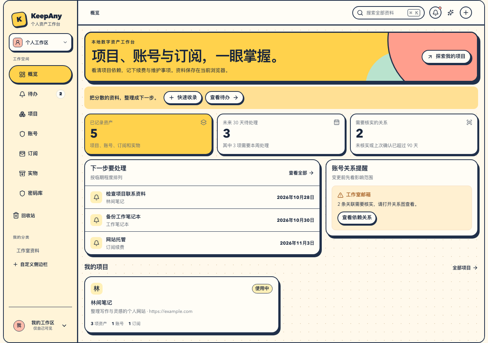

# KeepAny

**独立开发者的本地数字资产工作台。把项目、域名、账号、订阅和维护事项连起来。**

[English](README.en.md) · [官网](https://syndred.github.io/KeepAny/zh/) · [试用指南](docs/试用指南.md) · [发布记录](https://github.com/Syndred/KeepAny/releases) · [反馈问题](https://github.com/Syndred/KeepAny/issues)

项目统一使用 KeepAny，曾以 StackPerch 名称发布。旧 StackPerch GitHub 链接仍转到同一仓库；官网请使用上方的 KeepAny 地址。

一个项目用了哪个邮箱、在哪买的域名、有哪些订阅？换邮箱或停止维护时，还要处理哪些关联服务？KeepAny 把这些资料放进同一个本地工作区，让你沿着关联找到下一步。

无需注册。简体中文和英语界面。本地核心采用 [AGPL-3.0-only](LICENSE) 开源；未来可选付费托管，当前官方云同步和付费服务未开放。



*真实应用截图，内容为示例资料。*

## 下载与试用

**当前为早期测试版。** 请从 [GitHub Releases](https://github.com/Syndred/KeepAny/releases) 获取标注 `Pre-release` 的 `KeepAny-…-portable.zip`。发布页仅提供当前测试版，并列出对应源码版本、校验值和已知限制。不要把 GitHub 的源码 ZIP 当成便携应用包。

便携包需要 **[Node.js 22 或更新版本](https://nodejs.org/)**，无需 Git、pnpm 或编译源码。解压到一个固定文件夹后启动：

| 系统 | 启动 | 停止 |
|---|---|---|
| macOS | 双击 `start.command` | 双击 `stop.command` |
| Linux | 在包目录运行 `./start.sh` | 运行 `./stop.sh` |
| Windows | 双击 `start.bat` | 双击 `stop.bat` |

打开 **[http://127.0.0.1:4180/](http://127.0.0.1:4180/)**。服务仅监听本机；关闭浏览器不会停止服务。若端口已被其他程序使用，启动器会提示，不会改用另一个端口。同浏览器、同地址会显示已有的本地资料；想从空白开始，请自行使用独立浏览器配置。

已有 KeepAny 或 StackPerch 的 `.ka1` 加密备份和 `.kdbx` 密码库可继续使用；仍需各自原密码。更名不改变本地数据位置，使用原浏览器、原地址即可沿用已有资料。

旧版本升级前先下载并验证备份，保存当前编辑，关闭旧标签并停止旧服务，再用原浏览器、原地址打开新版。遇到应用更新提示，按提示保存修改后更新；端口冲突时先核查原服务。详见 [升级步骤](docs/试用指南.md#旧版本升级)，当前不保证所有旧 PWA 路径都已验证。

空白概览可点「用示例资料开始」，进入设置后点「加入示例资料」；也可从「设置 → 其他选项 → 加入示例资料」进入。然后试试：

1. 建立一个项目，填入网站或域名。
2. 记录登录账号，把它与项目关联。
3. 记录订阅、续费日期及关联项目。
4. 建立维护待办，查看账号的关联与变更影响。
5. 在「收录与备份」创建加密 `.ka1` 备份，**保存下载文件**，再在独立浏览器配置中预览并恢复。

安装要求、数据位置和恢复步骤见 [试用指南](docs/试用指南.md)。建议先用示例资料试用并完成一次恢复，再录入重要资料。

## 可以做什么

导航统一为「账号」和「资产」：账号和登录条目在同页管理，密码可留空；外部密码库引用保留在折叠区，详情里也可管理关联密码；资产汇总实物、项目、域名与订阅，并保留分类、标签、详情及费用账本。实物显示已购时长，项目显示待办进度，域名与订阅显示剩余时间；费用按记录与币种分别统计。

| 你要处理的事 | KeepAny 提供的本地功能 |
|---|---|
| 找到项目相关资料 | 项目、账号、订阅和实物；分类、标签、搜索与关系图 |
| 记住维护和费用 | 待办、订阅账期与续费记录、实物保修及借还历史 |
| 整理散落的记录 | 文字、CSV、URL、图片或 PDF 文字收录，预览核对后保存；可选自带模型辅助整理 |
| 更改登录方式前检查 | 账号关系、来源与核实时间，以及需要人工处理的变更影响清单 |
| 保管登录资料 | 独立加密 KDBX 密码库，支持导入、导出与审核式批量导入 |
| 带走自己的资料 | 加密 `.ka1` 备份与恢复，包括资料、图片、历史和本机密码库密文 |

域名可记录在项目资料及维护事项中；当前没有注册商接管或自动续费功能。账单和续费记录是你的台账，不代表第三方已扣款。变更清单不会代替你登录、换绑或取消服务。

## 数据与 AI

- 资料默认保存在**当前浏览器、配置文件和站点地址**的本机存储中。换浏览器、改端口或使用 `localhost` 会打开另一份资料；换电脑请先备份和恢复。清除站点数据可能删除本地资料。
- 本地核心可独立使用。同步不是备份；定期下载 `.ka1`，保留密码，并实际检查恢复结果。
- 密码和长期模型密钥保存在独立 KDBX，不写入普通资产、全局搜索、MCP 或资产同步。`.ka1` 携带的是密码库密文，恢复后仍需密码库主密码；主密码没有后台重置入口。
- AI 是可选的，需要你配置提供商或兼容服务。普通问答只发送你明确选择的有限资料字段；密码库智能导入的**全文 AI 识别**会在主动确认模型、地址和发送范围后，将本次清单全文（可能含账号、密码和备注）发给所选服务。它不读取或发送已有全库及主密码。结果核对后才写入。密码库「关联账号」另行只分析主动勾选的账号资料与经检查的关联线索；密码字段不会发给 AI。详见 [密码库说明](docs/密码库使用说明.md) 与 [AI 数据边界](docs/AI功能与验收合同.md)。

## 测试版的边界

当前主要面向愿意反馈问题的早期用户。本地功能已有自动化和浏览器验证，仍可能有缺陷；真实手机、所有系统与浏览器、低存储或突然断电等场景未全部验证。

官方托管、后台邮件与关页推送、浏览器密码自动填充、跨设备密码同步尚未提供。仓库内的同步服务、账户绑定、远端存储连接器和 MCP 有开发实现与局部验证，仍属于实验能力，不作为普通用户试用的必需步骤。当前不扩展商业功能，先完善本地使用和恢复。

具体限制以下载包的发布说明为准；详细验证与待办见 [项目进度](docs/08-项目进度交接.md)。

手机应用仍在独立开发分支，尚未发布商店版本。Android模拟器已有原生保存、加密备份、限定范围电脑配对和明确选中普通资料后的AI请求等局部证据。第二十包项目关键词、分类与多标签完整链已双语复验；其后发现的SQLite重载事务锁，经[有效OS五条件原红与修复](docs/mobile/AndroidSQLite事务五条件V3红绿回执-20261028.md)在第二十一包复验通过，[正式App原入口及两语AI全文](docs/mobile/Android第二十一候选启动与AI正文补证回执-20261028.md)已在同包复验，授权测试资料完整保持。关系图修复已有软件证据并进入新包，归还确认已有软件与gstack生产验证；[两品牌历史备份的Native保存与干净Web恢复](docs/mobile/F20历史Native导出干净Web双向回执-20261028.md)已核对完整资料和密码库密文。[保存按钮旁的结果提示](docs/mobile/Android第二十三候选备份反馈两语实装回执-20261028.md)已在第二十三包完成中英系统取消及同文件重试保存；媒体并发、其余Native及未验分支仍待。

[第二十五包保存失败反馈](docs/mobile/Android第二十五候选保存失败反馈Native定向复验-20261028.md)已完成中英文局部实装：正确错误提示留在当前预览／密码编辑框内，原草稿恢复后重试成功；原数据、图片、密码历史及已有备份保持。英文是实际权限拒写，中文是桥合成拒绝，实际磁盘满与系统保存目标失败仍待。

[第二十六包旧编辑冲突](docs/mobile/AndroidN26旧编辑CAS双语完整复验-20261028.md)已完成中英文原生复验：电脑获批修改后，手机旧稿保存被拒绝且草稿保持，错误与按钮完整可见；明确重读、重填并保存一次后，重开结果正确。其它资料、历史备份及配置保持。测试APK已交用户自行安装，尚无物理设备结果，其余类型和功能仍逐项验收。

[第二十八包统一界面复验](docs/mobile/AndroidN28统一组件与状态栏双语复验-20261028.md)已同步网页统一组件；Android模拟器中英实际验证顶部按钮避开系统栏、资产标签唯一选中、侧栏主入口44px，以及搜索键盘与返回。已交新测试APK；vivo X100 Pro／OriginOS 6和其它物理设备结果仍待，不能用模拟器覆盖真机验收。

[第二十九包网页同步交接](docs/mobile/AndroidN29网页同步与停止交接-20261028.md)继续合入最新账号密码同页、通用关系图与历史表单，中英文触屏／桌面完整流程已复验并生成同签名APK。N29模拟器因本机内存余量不足未启动，未把构建和浏览器通过记作新Native或真机通过；用户要求本轮收尾停止，后续待明确继续。

iOS 尚未全量通过：[8a5最新实际结果](docs/mobile/CI8a5实际执行与Apple局部归档补证-20261028.md)的Core29项通过，界面7项通过／1项失败；英文取消草稿出现ASCII空格缺失，中文完整字段和普通待办通过。新的[输入屏障与共享日历测试候选](docs/mobile/iOS空格前缀屏障与统一日历测试适配候选-20261028.md)仍待真实Apple执行。该旧源码轮的general与portable另有超时或启动空白失败，原因继续定位；三种桌面系统交付检查通过不等于全部功能通过。Native及物理设备分别记账，详见[手机测试表](docs/mobile/手机功能详细测试表-20261027.md)。

## 从源码运行

使用 Node.js 22+ 和 pnpm 11.10.0。先安装指定 pnpm（Node.js 25+ 不再预装 Corepack），再依锁文件安装：

```bash
npm install --global pnpm@11.10.0
pnpm install --frozen-lockfile
pnpm dev
```

开发地址默认是 `http://127.0.0.1:5173/`，与便携包的 4180 资料分开。发布固定本地包的操作见 [release/README.md](release/README.md)。

```bash
pnpm typecheck
pnpm test
pnpm build
```

涉及同步测试时需要隔离 PostgreSQL；参与开发前请读 [贡献指南](CONTRIBUTING.md)。`apps/web` 是正式 React 应用，`packages/*` 是领域模型、本地仓库与连接器；设计 HTML 仅为档案。

## 参与与许可证

欢迎反馈：哪个步骤没完成、找一份资料用了多久、录入哪里费力。请附应用版本、系统、浏览器和可复现步骤，使用虚构资料；不要上传真实密码、API Key 或备份文件。安全问题请按 [安全报告指南](SECURITY.md) 处理。

KeepAny 本地核心使用 [AGPL-3.0-only](LICENSE)。依赖声明与第三方材料见 [NOTICE.md](NOTICE.md)、[SBOM.spdx.json](SBOM.spdx.json) 和 [legal/third-party](legal/third-party)。商业使用须遵守相应许可证。

未来的付费服务计划解决托管、存储和运维；本地读写与完整导出不以付费为条件。商业网站、支付和运营后台属于独立的 KeepAnyAdm 商业仓库，不随本仓库分发。见 [产品边界](docs/00-产品范围与开放边界.md)。
