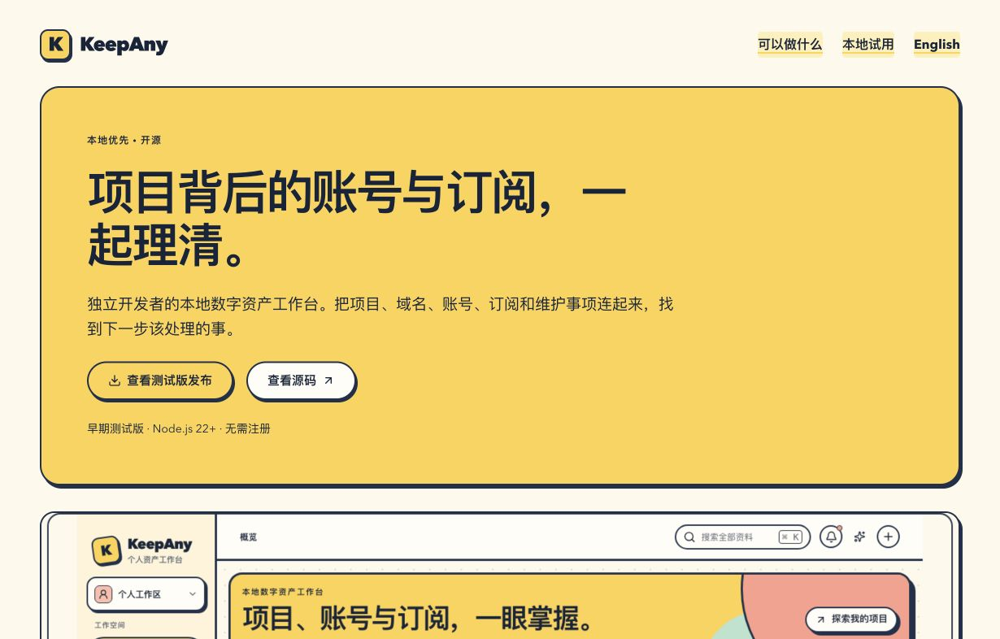
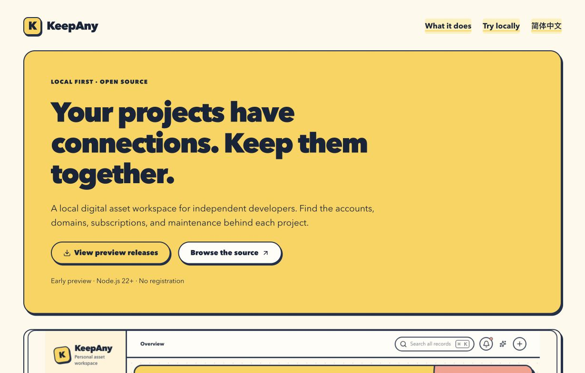
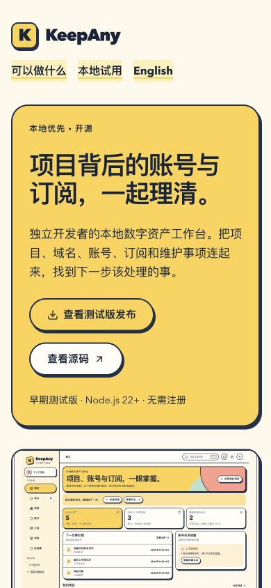
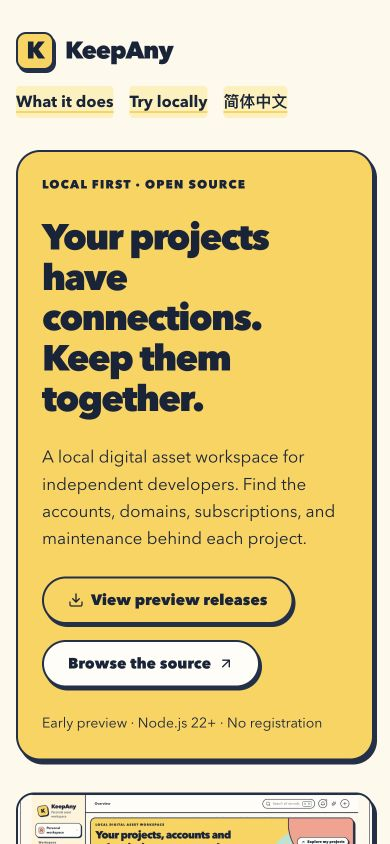
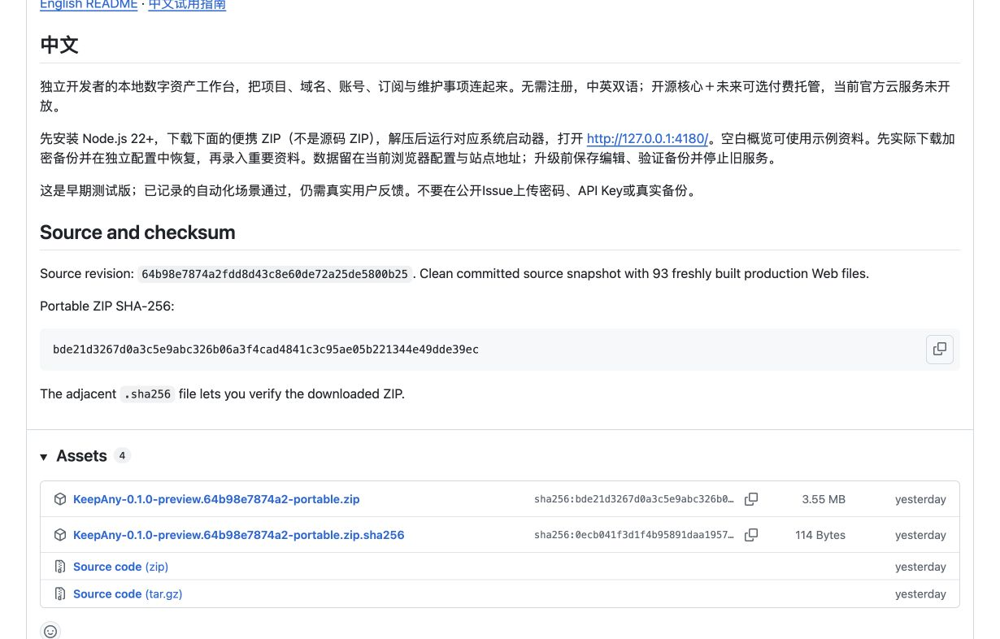

# KeepAny 开源预览版发布回执（2026-10-12）

源码公开、便携测试版和中英介绍页已实际上线。定位为独立开发者的本地数字资产工作台，AGPL-3.0-only 开源核心＋未来可选付费托管；官方托管未开放，商业功能未扩展，KeepAnyAdm 不随核心分发。

## 发布身份与入口

- [公开仓库](https://github.com/Syndred/KeepAny)。中英 README、试用、贡献及安全报告入口匿名可读。
- [便携预发布](https://github.com/Syndred/KeepAny/releases/tag/v0.1.0-preview.20261011)，`prerelease=true`、`draft=false`；精确 tag 解析为 `64b98e7874a2fdd8d43c8e60de72a25de5800b25`。
- ZIP `KeepAny-0.1.0-preview.64b98e7874a2-portable.zip`；实际匿名下载 SHA-256 为 `bde21d3267d0a3c5e9abc326b06a3f4cad4841c3c95ae05b221344e49dde39ec`，与上传前独立固定值、公开 `.sha256` 及包内逐文件清单匹配。对应源码 `sourceDirty=false`，93 个新构建 Web 文件，无历史资源或 node_modules。
- [中文介绍页](https://syndred.github.io/KeepAny/zh/)／[English](https://syndred.github.io/KeepAny/)。需要 Node.js 22+，解压后运行系统对应 start 文件；无需 Git、pnpm、编译或注册，停止用对应 stop 文件。

## 最终验收证据

| 层次 | 实际结果 |
|---|---|
| 同源码 CI | [38136079738](https://github.com/Syndred/KeepAny/actions/runs/38136079738) 全部 success；84文件786单测、5并发回归、固定交付178、仓库外便携178、实际PG/HTTP同步2、离线清单1通过 |
| 三系统包 | [38136079762](https://github.com/Syndred/KeepAny/actions/runs/38136079762) macOS／Windows／Linux全部 success；新构建、材料检查、仓库外原生解压、实际系统启动/停止与安全控制通过 |
| Pages | [38233667114](https://github.com/Syndred/KeepAny/actions/runs/38233667114) success；相同源码双工作流成功门槛实际通过，部署仅公开文档产物 |
| 匿名公开验收 | [17/17报告](public-verification.json)：仓库、预发布、tag、源码、真实下载与固定hash、双语HTML/meta、sitemap、llms、三种bot标识×两语言、根robots及9公开文件hash通过 |
| 下载包原生 | [6组通过](public-download-native.json)：从真实公开下载ZIP在仓库外解压，实际macOS启动、路由、安全控制、端口冲突及停止；未使用源码开发服务 |
| 下载包首次使用 | [4/4](public-download-onboarding.json)，中英390/1280px；空白入口→示例→保存→刷新保留，无溢出、0跳过／失败／flaky |
| 真实网页截图 | 中英实际公开页面390/1230px截图已目检，图片完整、按钮与卡片有间距。见下方截图 |

测试层次会重叠，不相加声称独立总数。旧PWA升级1项和原生低配额2项的额外范围及历史初轮失败见[发布前验收](../../2026-10-11/preview/验收记录.md)。本地完整178项使用bee3c1a ZIP；最终93个应用文件逐字节相同，见[对应证明](runtime-equivalence.json)，最终64b98e7也有独立完整云端178项通过。

## 收口修复与保留的失败记录

3bc4752云端便携177/178暴露旧候选快照覆盖跨行新编辑。先确定性复现DB已保存item但UI变回project，再修复读取代号／编辑修订号、等待保存、只保留pending失败草稿，补搜索迟回与旧失败提示保护。5个故障/并发场景和相关24项通过，最终完整流程通过，未用重试隐藏应用竞态。

502a30e三系统首次Windows在启动状态文件刚独占创建、内容尚未写完时被验证器立即拒绝。64b98e7仅使启动轮询有界等待未完整JSON；永久损坏100次后仍失败并保留cause，子进程退出与监听安全断言立即失败。[实函数4项故障注入](startup-readiness-checks.json)及最终三系统通过；启动器wx独占保护未改。

匿名初轮16/17的唯一失败是要求GitHub Pages公开部署标记 `.nojekyll`。该标记真实404；[首次报告](public-verification-initial.json)保留。校验改为9个用户公开资源必须200且逐字节一致，部署标记单独记录404；未放宽任何用户文件、下载、页面或爬虫断言。

许可证、历史秘密与媒体审计见[开源审计](../../../开源发布审计-2026-10-11.md)。bee增量4项独立归类为1个静态hash及3个翻译key、0凭据／未分类；后续两提交扫描407与945bytes均0发现。发布截图来自已公开页面，应用示例和测试始终合成资料。

## 抓取边界

公开HTML无需JavaScript读取，canonical、hreflang、OG、SoftwareApplication、sitemap和llms已回读。OAI-SearchBot、GPTBot、ChatGPT-User标识请求六次均200；这是可访问性检查，不是这些爬虫实际到访的证明。

域名根 `https://syndred.github.io/robots.txt` 实际404，按[RFC 9309](https://www.rfc-editor.org/rfc/rfc9309.html#section-2.3.1.3)没有由该响应施加的robots规则。项目路径 `/KeepAny/robots.txt` 已上线，但只是模板，不当成域名根策略。OAI-SearchBot用于搜索，GPTBot用于模型训练，ChatGPT-User用于用户触发访问，见[OpenAI官方说明](https://developers.openai.com/api/docs/bots)。允许访问、llms文件及结构化数据均不保证索引、排名或GPT推荐。

## 提交、数据与清理

发布tag与安装包固定在已完整通过验收的64b98e7。发布后的本回执仅新增文档、脱敏结果和公开截图，不修改应用、打包器或公开站点源码；回执提交使用[GitHub文档允许的skip ci](https://docs.github.com/en/actions/how-tos/manage-workflow-runs/skip-workflow-runs)，不把回执HEAD称为另一次完整CI成功，也不改变未来发布的同SHA门槛。

本轮临时测试服务器与测试隔离浏览器已结束；公开发布页与中文介绍页作为成果保留两个标签，用户原4180（PID10524）、4186（PID30746）保留，原Ego页未刷新、真实KDBX未读写。临时配置移除，旧候选包可恢复地移至本机废纸篓；最终ZIP、实际匿名下载、公开页构建及本地原始证据留原仓库忽略目录，隔离工作树归档已向管理工具提交；目前仅返回queued，仍显示活动附件，尚不能记为归档完成。保留已同步的工作树，等待管理器处理，不绕过管理器删除。原始secret/OCR报告仍只在临时目录；不随开源发布。

无已识别功能阻塞；剩余仅管理工具的工作树归档回读。真实手机、所有浏览器／历史升级路径、真实模型准确率、突然断电仍不是本轮证明范围；测试版仍需真实用户反馈。公开下载首次补验的临时配置曾因cwd错误在0用例时启动失败；修正为原仓库cwd后上述4项通过，原诊断留本地忽略证据，不计作功能测试成功。

