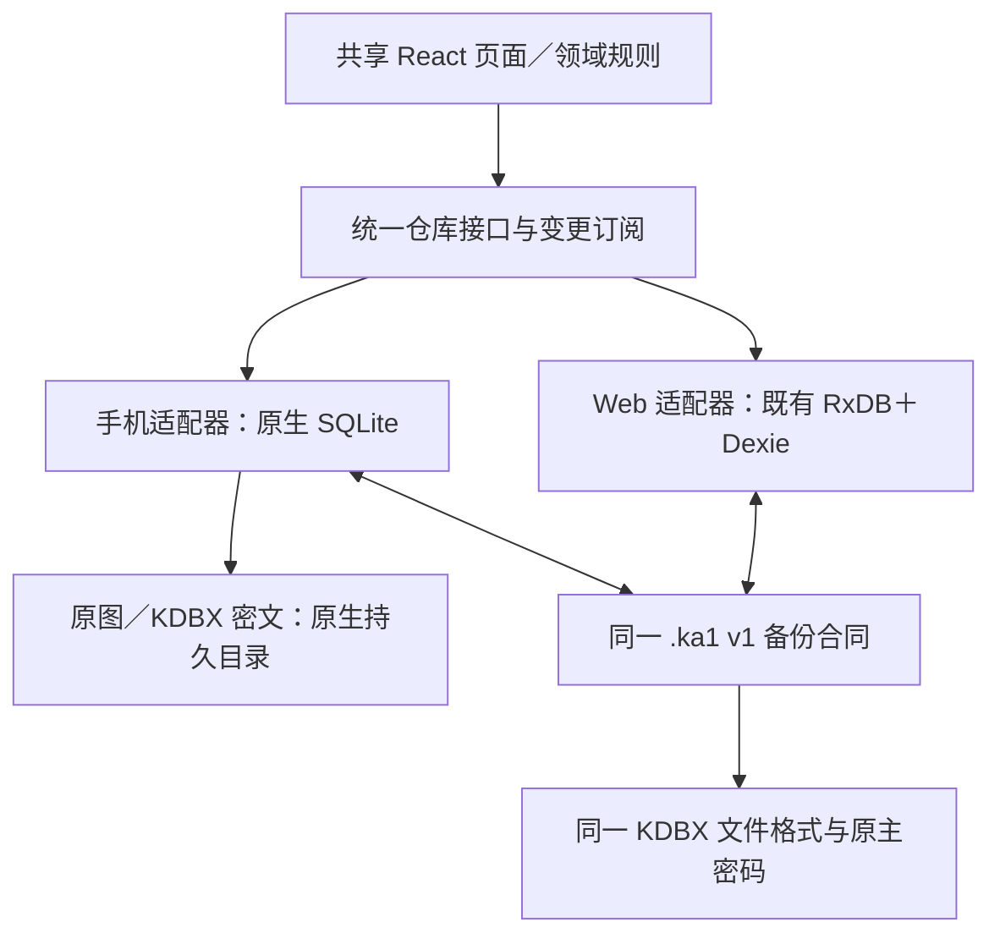

# Capacitor＋原生 SQLite 迁移方案

日期：2026-10-27。代码核对基线：`65636dbb650e6b4bdb3af4a42c2f6469db07e662`。

状态：**选型已由用户确认；本文件与手机草图待确认；尚未实施数据层迁移。** 本轮只增加方案、交互草图和检查证据，不运行真实资料导出、恢复或迁移。

2026-10-27后续修订：用户指出第一稿功能覆盖不足，要求账号／密码共用入口、项目／域名／订阅／实物统一到资产。当前界面方案以[手机功能整合与完整覆盖v2](手机功能整合与完整覆盖-v2-20261027.md)与003草图为准；底栏为概览／资产／账号／待办／更多。入口整合继续保持独立KDBX、原始资产kind／ID、`.ka1 v1`及本文件全部数据兼容规则，不能按页面分组重写底层记录。

## 1. 本轮建议

保留 React／Vite、现有领域模型、业务规则、路由、国际化及暖黄主题。手机安装包采用 Capacitor，核心数据通过原生 SQLite 保存，原图和 KDBX 密文保存到应用持久文件目录。

现有电脑 Web／PWA 继续使用原来的 RxDB／Dexie、浏览器配置、地址与 4180 端口。先把它包装成同一仓库接口的 Web 适配器，再新增手机适配器。每个平台只启用一个资产仓库，禁止同时双写两套主库。此次选型不等于同时批准替换电脑数据库。

手机首次取得电脑资料，走现有加密 `.ka1` 导出／恢复路径。手机不能直接打开电脑浏览器的 IndexedDB，Capacitor WebView 也不会自动继承 Safari／Chrome 原来的站点资料。

## 2. 已核对的现状与影响

| 源码入口 | 当前职责 | 迁移要求 |
|---|---|---|
| `packages/local-db/src/index.ts` | RxDB `records`，`RecordRow {id,type,payload,updatedAt}`；Dexie `FileStore` v12 | 保留 ID、原始业务字段和时间；把数据库实现与应用接口分开 |
| 同文件 `FileStore` | 18 张表，涵盖文件、日志、同步状态、审核、密码库密文 | 不能只迁 `records`；逐项按下表映射 |
| `apps/web/src/data.ts` | RxDB 查询订阅，以及 Dexie `liveQuery` 读取审核与分类待处理状态 | 改依赖仓库快照／变更事件；保留加载、错误、未完成状态 |
| `apps/web/src/intake-review-store.ts` | 直接使用 `repository.fileStore` | 抽成接口方法，手机路径不得依赖 Dexie |
| `apps/web/src/components/RestoreRecoveryPanel.tsx` | 同时订阅 RxDB 和 Dexie | 改为同一个仓库的恢复状态订阅 |
| `packages/password-vault/src/types.ts` | 已有 `VaultPersistence.read/write(expectedRevision)` | 复用接口、引擎和条件写入，换底层密文文件存储 |
| `packages/local-db/src/backup-crypto.ts`、`archive-unzip.ts`、`inspectArchive` | 加密容器、解压预算、hash、引用与归属检查 | 提取为无平台依赖的共用备份模块，沿用原算法和拒绝规则 |
| `packages/binding/src/store.ts` | 独立 Dexie 存设备身份、不可导出 CryptoKey、绑定与 refresh token | 属于设备凭据；新手机新建身份，禁止照搬电脑凭据 |
| `apps/web/src/ai-settings-store.ts`、`page-settings.tsx` | 模型配置、语言、远端选择部分使用 localStorage | 非敏感配置改接原生 Preferences；长期密钥仍进 KDBX |

这里的普通 `asset.kind='vault'` 是既有资产类别，**不等于独立 KDBX 密码库**；保留现有语义和关联字段。

### 全部 FileStore 表的去向

| 当前表 | 手机目标 | 跨设备 `.ka1` 行为 |
|---|---|---|
| `blobs` | SQLite 文件目录表＋持久目录原始字节 | 按现有清单保存 ID／文件名／MIME／大小／SHA-256；不重新压图 |
| `intakeReview` | SQLite 审核记录表 | 保留原文、候选、审核决定、关联历史与 ID |
| `passwordVault` | 独立 `.kdbx` 密文文件＋revision／updatedAt 元数据 | 原密文及元数据保持；不要求解锁才能迁入 |
| `journal`、`importJournal`、`renewalJournal`、`subscriptionSaveJournal`、`categoryEditJournal`、`archiveMerge` | SQLite 持久操作日志；跨文件流程保留检查点 | 现有导出先结清可恢复操作；无法结清时拒绝导出并显示原恢复入口，不把半成品伪装为完整备份 |
| `syncBase`、`syncMeta`、`pullJournal` | SQLite 设备同步状态 | 现有 `.ka1` 不搬这三表；新设备重新建立基线 |
| `scopedBase`、`scopedMeta`、`scopedOutbox`、`scopedPull`、`scopedAttachmentUploads` | SQLite 带 scope 的队列／游标／冲突／图片计划 | 不复制另一设备在途请求；按现有加入流程建立本机状态 |
| `datasetBinding` | SQLite 资料来源归属 | `.ka1` 的 `sourceBinding` 按原规则保留；不代表新设备已经获授权或同步完成 |

旧收录数据库的兼容读取还在 `packages/local-db/src/intake-review.ts`。电脑 Web 适配器继续执行原有旧库整理，再生成 `.ka1`，手机不另造一个只搬部分资料的导出器。

## 3. 存储位置与“不会被清缓存”的边界

| 内容 | iOS 目标位置 | Android 目标位置 |
|---|---|---|
| 原生 SQLite、操作日志 | `Library/Application Support/KeepAny/databases/` | 应用内部数据库目录，由原生 SQLite 插件创建 |
| 原图、KDBX 密文、尚未完成的恢复文件 | `Library/Application Support/KeepAny/` 的独立子目录 | 应用内部 `filesDir` 子目录 |
| 缩略图、可重新生成的预览 | Cache | 内部 cacheDir |
| 用户独立备份 | 用户通过系统保存界面选择的文件位置 | 用户通过系统文件保存界面选择的位置 |

核心文件只能存非缓存的应用持久目录，路径由原生 API 解析，不能写死设备上的绝对容器地址。启动后读取数据库真实 URL，检查不在 Cache／tmp；缺插件、错误目录、打不开数据库时显示恢复入口，禁止静默退回 IndexedDB 或另开空库。

这能避免系统按缓存策略回收业务数据。用户清除应用数据、删除 App、设备丢失／损坏仍由独立备份恢复。空间不足时允许保存失败并明确提示，不能先报成功再丢写入。

**系统备份需要独立核对。** 已查到 SQLite 插件的 iOS `createDatabaseLocation` 会把新目录排除出 iCloud Backup。不能只因为使用 Application Support 就宣称已有 iCloud 备份；首版以主动导出的 `.ka1` 为可带走的备份，不在草图上显示自动云备份成功。

## 4. 依赖与复用

- Capacitor 使用同一已验证主版本的 core／CLI／Android／iOS 与官方插件；具体补丁版本在阶段 M0 固定并写锁文件，本轮不安装或更新依赖。
- 原生 SQLite 候选固定核对 `@capacitor-community/sqlite@8.1.1`，上游 release commit 前缀 `3f3f716`，包声明 MIT；其 package 配置、事务接口及 iOS 路径解析源码已查。正式接入前解析完整 commit、核对原生依赖和许可证，并通过双平台验证后锁定。
- 直接使用插件的参数化查询、批次、事务和数据库升级能力，不用插件 JSON 导出替代 `.ka1`，不用其简化同步表替代现有同步协议。
- 文件／生命周期／键盘／返回键／分享优先使用官方 Capacitor 插件。系统导入／保存选择器先查维护中的插件；缺能力时只写最小平台桥接，不写自制文件系统或 SQLite 引擎。
- 正式页面复用现有 React、Radix Dialog／Select、React Hook Form／Zod、Lucide、React Flow 组件与设计变量；草图 HTML 不进入生产应用。
- SQLite 不自动等于完整加密。密码仍仅存 KDBX；普通资料是否启用 SQLCipher 与其密钥生命周期在 M0 单独确定，不因为插件支持加密就宣称已提供。

## 5. 仓库接口与 SQLite 第一版结构

### 接口边界

建议新增 `packages/repository-contracts`，由现有 `packages/local-db` 的门面选择 Web／Native 实现；原来的导入路径可逐步保留为兼容门面。新增 `packages/local-db-native` 实现手机仓库，新增 `packages/platform-native` 封装文件／生命周期。目录为计划，不冒称已建立。

保留现有方法含义：CRUD、`save*IfCurrent`、条件删除／恢复、批次保存、续费与实物历史、审核草稿、分类编辑、回收站、同步／迁移、备份、`VaultPersistence`。接口不再向页面暴露 `RxDatabase`、Dexie Table 或原始文件句柄。

查询使用数据库快照＋提交后的变更版本；React 消费订阅和现有 `useData` 派生数据。可复用 React `useSyncExternalStore` 接口，先验证当前查询量；不自制 RxDB 查询引擎。提交前不通知保存成功，失败不清空已显示资料；过期异步查询不得覆盖新快照。TanStack Query 继续只管远端状态。

### SQL 形状

首版用 `records(id TEXT PRIMARY KEY, type TEXT, payload TEXT, updated_at INTEGER, revision INTEGER)` 保留现有包络与 JSON 业务内容。按当前查询建立 `type` 等索引，不在本次迁移中把业务拆成大量新关系表。金额仍按原整数最小单位、纯日期仍按原字符串处理。

审核、文件清单、来源归属、日志、同步状态使用独立表，必要的唯一键、scope、操作 ID 和 CAS 版本保持。SQLite 内部 `user_version` 与业务 schema／备份 version 分开，禁止因换引擎修改 `.ka1` version。

条件写入按记录 revision／原 payload 检查，检查和修改在同一个事务完成；多步业务提交与历史成对落库。沿用领域校验和现有幂等 ID，不把旧 `_rev`、`_meta` 等 RxDB 内部字段当业务数据迁入。

### 文件与数据库之间的一致性

原生文件写入和 SQLite 事务不天然原子。使用“不可变文件＋数据库指针＋持久操作记录”：

1. 将新文件写入持久目录的新版本路径，不覆盖仍在使用的原图／KDBX。
2. 读回大小与 SHA-256，核对内容后才进入数据库事务。
3. 在同一事务写文件清单／引用／KDBX revision 和操作状态，提交后发布变更。
4. 崩溃在提交前只留下未引用文件；重开按日志恢复／清理。提交后旧文件保留至确认无引用，再延后回收。
5. 对 KDBX 沿用 `expectedRevision`；旧编辑不能覆盖新密码库。备份快照持有旧文件引用直到打包结束。

M0 验证 SQLite WAL／事务／同步落盘配置与原生文件读回。普通插件 rename 或“写入返回”不能证明突然断电时已完整落盘；真机杀进程／低存储与断电证据分开记录。不得仅把正在打开的 `.db` 拷贝当作完整备份，WAL 与跨文件引用仍需一致快照。

## 6. 备份与数据兼容合同

| 项目 | 必须保留 |
|---|---|
| `.ka1` 外容器 | `KEEPANY1`、PBKDF2-SHA256 600000 次、AES-256-GCM、现有 salt／IV／AAD 布局、最少 12 字符的创建密码要求 |
| 内部清单 | `format: keepany-backup`、`version: 1`；`manifest.json`／`records.json`／可选 `intake-review.json`、`password-vault.kdbx`、`files/<uuid>` |
| 普通资料 | 既有七类记录、ID、名称／title、额外登录标识、分类／标签、关系用途／方向／来源／核验时间、金额／币种／日期 |
| 历史与删除 | 已完成任务、续费／借还历史、普通资产与关系的删除墓碑、回收站、项目维护轮次、集合及普通 preference |
| 图片 | 原始字节、ID、名称、MIME、大小、SHA-256；不重新编码、不换 ID |
| 审核 | 原文、候选、草稿、审核状态、来源和关联资料／历史 ID |
| 密码库 | 原 KDBX 版本／参数、原主密码、条目 UUID、额外登录标识、自定义字段、关联 ID、历史／回收站和加密导入草稿；迁移只搬密文 |
| 来源 | 既有 `sourceBinding` 以及冲突／跨来源迁移规则；资料归属与本机设备授权分开 |
| 预算与拒绝 | 压缩内容 100 MiB、实际解压 300 MiB、单图 20 MiB、KDBX 16 MiB、原数量／路径／哈希／引用检查；错误密码、篡改、冲突不产生部分有效资料 |

保留当前已支持的历史格式读取分支，包括没有审核记录／密码库的旧 v1 包。新手机导出的 v1 包必须能由基线 `65636db` 及选定历史 KeepAny／StackPerch 测试包恢复。遇到老版本根本不认识的新业务字段，先限制该功能的发布，再单独设计版本演进，不能把任意历史版本都承诺为兼容。

**不带走设备凭据。** 浏览器 CryptoKey 不是可复制 JSON；设备私钥、refresh token、MCP 授权、在途同步队列不进入普通备份。工作区密钥沿用既有独立加入／恢复流程，新手机重新授权。新手机只恢复资料不显示“同步完成”。

语言、非敏感模型配置等当前 `.ka1` 未包含的 localStorage 内容，明确列为需重选／重新配置；本次不偷偷扩充 v1 格式。已有 KDBX 中的模型密钥引用随密文保留，仍需原主密码。

## 7. 用户实际迁入流程

### 电脑 → 新手机（首版推荐）

1. 在原浏览器、原地址完成现有待处理恢复，使用已有入口生成加密 `.ka1`，选择保存位置并确认文件可读。
2. 用系统文件传输把该加密文件带到手机；应用不自动上传真实资料，不需要商业账号。
3. 手机“从备份恢复”选择文件、输入**备份密码**；先解密、预检和展示资料／关系／原图／任务／审核／回收站／密码库的范围。
4. 默认写入一个新的本机资料集。已有手机资料时给出“保留当前，恢复为另一资料集”的路径；合并沿用现有冲突规则另行核对，不整库覆盖。
5. 原生库与持久文件先写到候选资料集，全部提交后关闭／重开目标库并核对 ID、内容、哈希及关系引用，再切换活动资料集指针。
6. 完成后报告实际恢复数量，密码库保持锁定；用原主密码另行打开。电脑原库和导出文件继续保留。

### 同一手机未来从 WebView 旧库升级

仅在同一应用容器、原 origin 确实能访问旧 IndexedDB 时，才能提供“本机旧资料迁移”。先结清旧日志、导出并验证快照，阻止旧标签／旧版本继续写，写新候选库，核对后切换；源库保留且不双写。若来源不可访问，直接指向 `.ka1`，不能报“没有资料”或自动建空库掩盖问题。首版没有此类正式安装用户，不把该路径作为从电脑导入的替代。

### 中断、失败与回退

- 活动资料集指针保存在独立 `control.sqlite` 的单行元数据中，只在候选完整、关闭／重开核对通过后以 SQLite 事务更新；候选资料集在切换前保持冻结。记录 `prepared → verified → active` 状态与迁移 ID。
- 导入时空间不足、文件缺失、错误密码／哈希、KDBX冲突：保留原活动资料，不切换、不报恢复成功。
- 用户取消系统文件选择无写入；导入过程中退出，下次显示“继续恢复／保留当前资料”；按日志幂等重试。
- 切换前可直接放弃候选。切换后若已新增资料，先导出新 `.ka1`，再走显式恢复／合并；不能把切回旧库包装成无损回滚。
- 独立备份保存必须区分“已生成文件”“已打开保存界面”和经回读确认的“已保存”；取消分享或选不到保存位置不能显示保存成功。

## 8. 手机草图与交互范围

预览位于 `.planning/sketches/`，全部使用虚构资料，只在内存演示，不接真实数据库、密码或 AI。

| 草图 | 比较点 | 建议 |
|---|---|---|
| 001 日常使用（旧稿） | 原概览／资料与独立密码库入口 | 用户指出功能覆盖不足，已退回；保留历史比较 |
| 002 迁入与备份 | A：全页核对、完整范围清单；B：紧凑核对与底部操作区 | 推荐 A，重要恢复操作易看清来源、范围和目标 |
| 003 资产与账号整合v2 | 底栏概览／资产／账号／待办／更多；A分类卡片／B紧凑清单 | 推荐A；账号原位管理密码，资产汇总年限／待办进度／日期／费用，完整功能去向见v2文档 |

手机页面：概览、资产类型筛选／搜索、项目／域名／订阅／实物详情、统一账号与密码及关系／换绑、待办、完整工具入口、首次恢复、恢复核对／中断／错误、备份与数据。密码锁定／解锁嵌在统一账号界面，现有功能不得因为导航缩减而删除。

页面边距 16px，卡片间距 12–16px，分组间距 24px；主要触控区域至少 44×44px。正文 14–16px，核心名称不压成逐字竖排。底栏保留安全区域；软键盘出现时主要表单与错误提示可见。列表返回保留滚动和筛选；关系默认可读的关联列表，图谱沿用 React Flow 全屏查看与明确返回。

草图切换／宽度／演示状态说明放在设备框外；手机内部只出现用户文案。正式实现仍使用 zh-CN／en 文案 key 和现有主题，不把 SQLite、CAS、SHA 或“实现待办”放进普通产品操作。

## 9. 分阶段实施与退出门槛

| 阶段 | 工作与提交范围 | 验收后才进入下一步 |
|---|---|---|
| M0 原生可行性 | 新建独立 mobile 容器；核对许可／固定版本；原生 SQLite 和持久文件探针；KDBX／备份加密在真机运行 | Android＋iPhone 确认真实数据库路径、清缓存后保留、杀进程重开、低存储失败可见；插件不得走 Web fallback；记录性能和内存。无设备时可做模拟器预验，但真机门槛保留 |
| M1 仓库接口 | 原 RxDB／Dexie 包成 Web 适配器；移除页面的数据库对象泄漏；通用备份模块 | 旧 Web 的现有测试、固定包升级与 `.ka1` 恢复回归通过；4180 和现有资料无变更 |
| M2 原生仓库 | `records`、18表语义映射、变更订阅、CAS、原图与KDBX持久化、操作恢复 | 同一合成输入分别跑 Web／Native 合同，逻辑结果一致；失败无虚假成功，无第二份资产主状态 |
| M3 备份迁入 | 共用 `.ka1`、候选资料集、核对／切换／恢复中断、系统保存／读取 | 历史包→手机→当前Web双向恢复；密码与原图完整，原资料保留；重试与重复导入幂等 |
| M4 手机交互 | 按已选草图做正式 React 页；系统返回、键盘、安全区域、文件选择、后台锁定 | 中英360／390／430、平板768、桌面1280截图和按钮／卡片间距；iOS／Android实际操作可达 |
| M5 发布验收 | 打包签名、升级／降级提示、恢复指南、依赖清单与交付回执 | 无网创建→关联→续费／待办→杀进程重开→外部备份→干净安装恢复完整链路；真实设备／中断证据齐全才称可发布 |

手机初版本地核心不依赖云同步。现有同步合同保持，但移动鉴权、设备私钥的 Keychain／Keystore 存储、工作区加入、跨设备冲突和撤销需单独实现／验收后才开放；不把 Web 端实验状态升级为已完成。

## 10. 必跑的兼容与故障矩阵

| 编号 | 样本／操作 | 通过标准 |
|---|---|---|
| C01 | 原 KeepAny `64b98e7`、StackPerch `7ebc` 基线及当前 `65636db` 的已支持合成备份 | 三者恢复到 Native 的领域快照、ID、删除状态、金额、日期、关系和图片 hash 与来源一致；历史基线先解析完整 commit 并复用现有升级夹具 |
| C02 | Native 导出→当前 Web；旧格式无可选审核／密码库字段 | 当前解密与预检原函数接受；重开后逐项相等；缺失可选部分不误报损坏 |
| C03 | KDBX3／4支持参数、多个标识、关联、历史、回收站、加密草稿 | 导入前后原密文字节相同；原主密码可解锁；编辑后旧版引擎仍可回读；不自动降低 KDF |
| C04 | 两份同 ID 不同内容、不同归属、不同KDBX、缺图、篡改、超预算ZIP | 写入前明确冲突／拒绝；活动库、文件指针和既有密码库保持 |
| C05 | 候选建库、文件写完、数据库提交、核对、活动指针切换各步骤杀进程 | 重开可读旧完整集或新完整集；不会呈现半恢复集；重试不会重复历史／图片／关系 |
| C06 | 文件写盘空间不足、原生数据库打不开、迁移版本未知、保存界面取消 | 可见失败／取消；不报“已保存／恢复成功”，不转为另一个空库 |
| C07 | 应用升级、系统清缓存、无网、锁屏、切后台后重开 | 核心资料／原图／KDBX保持；密码库按策略锁定；普通资料可离线读写 |
| C08 | 100／1000／10000资产，关系与原图，接近100MiB压缩／300MiB解压预算 | 记录机型／系统、读写／搜索／恢复耗时与峰值内存。能力不够就阻止发布或设计兼容的内存优化，不悄悄缩小旧备份支持范围 |
| C09 | 双视图编辑／续费／删除与保存穿插，订阅月底／闰年、不同币种 | 复用现有并发与领域用例：CAS失败明确、历史不重复、金额与日期无变化 |
| C10 | 新手机重新加入工作区／旧设备撤销（后续开放同步时） | 来源保留、新设备凭据独立、队列幂等、错误密钥拒绝，状态按事实显示 |

浏览器草图检查只证明展示与演示交互；SQLite 本机探针只证明宿主 SQLite；模拟器也不代替真实设备。每阶段证据分别记录，不用一个“测试全过”覆盖未实施功能。

## 11. 当前交付、未完成与下一步

- 已完成：源码与全部存储表／备份合同核对、官方依赖与持久目录规则核对、本迁移方案；草图与浏览器检查结果在对应 README／证据目录补充。
- 未完成：原生工程、接口重构、SQLite适配、真实数据迁移、真机存储／恢复／低空间验证、安装包与发布。
- 当前阻塞：没有阻碍方案与草图交付的问题。进入正式手机布局实现前，需要用户选择／修改草图；后续真机验收依赖实际设备。
- 下一步：先确认草图与分平台仓库范围，再执行 M0。任何阶段都先使用合成资料，不把当前电脑真实数据作为探针输入。
- 提交／推送／部署：由本轮交接记录实际结果；本方案不能作为已迁移或已发布的证明。

## 12. 官方依据（2026-10-27查阅）

- [Capacitor 接入现有 Web 工程](https://capacitorjs.com/docs/getting-started)
- [Capacitor 存储边界](https://capacitorjs.com/docs/guides/storage)
- [SQLite 插件 v8.1.1 发布](https://github.com/capacitor-community/sqlite/releases/tag/v8.1.1)、[固定版本 package／MIT 声明](https://github.com/capacitor-community/sqlite/blob/v8.1.1/package.json)
- [固定版本事务接口](https://github.com/capacitor-community/sqlite/blob/v8.1.1/docs/APIDBConnection.md)
- [固定版本 iOS 目录解析及排除系统备份行为](https://github.com/capacitor-community/sqlite/blob/v8.1.1/ios/Plugin/Utils/UtilsFile.swift)
- [官方 Filesystem API／持久目录](https://capacitorjs.com/docs/apis/filesystem)、[应用生命周期与返回](https://capacitorjs.com/docs/apis/app)
- [Apple 目录规则](https://developer.apple.com/library/archive/documentation/FileManagement/Conceptual/FileSystemProgrammingGuide/FileSystemOverview/FileSystemOverview.html)、[Android 应用内部持久文件](https://developer.android.com/training/data-storage/app-specific)

上述链接用于设计依据；具体版本组合和实际目录必须通过 M0，不把文档能力当作本项目已通过的验收。
